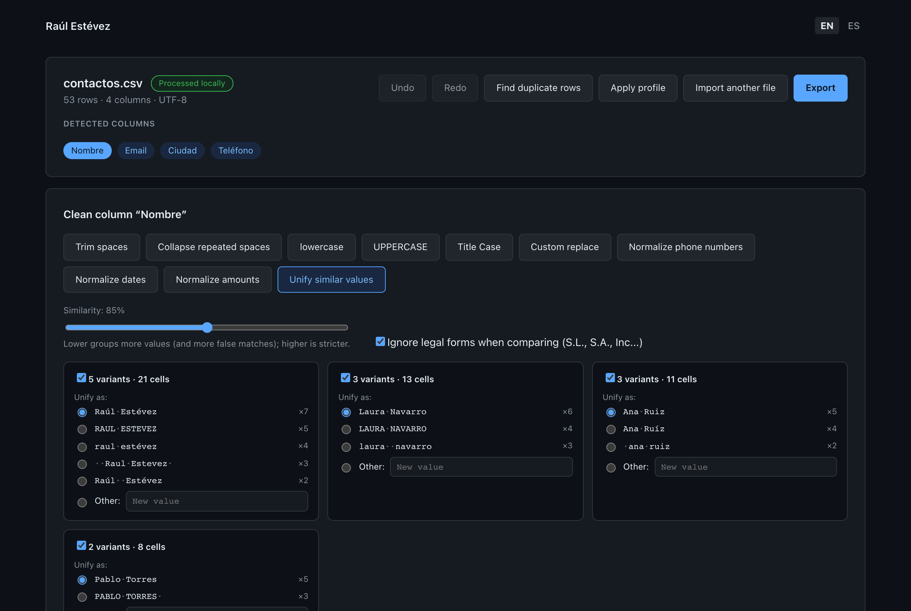

# DataCleanr

Client-side tool for cleaning, normalizing and deduplicating CSV, Excel, JSON and XML data **without sending files to a server**.

**Try it online:** [raulesteveza.github.io/tools/DataCleanr](https://raulesteveza.github.io/tools/DataCleanr/)

- 🇬🇧 **English:** [Full documentation](./README_en.md)
- 🇪🇸 **Español:** [Documentación completa](./README_es.md)

  

## What is this repository?

DataCleanr helps prepare messy data before loading it into a database or another system: extra spaces, inconsistent case, phone numbers and dates written in different ways, duplicates, and values like `Raúl Estévez`, `RAUL ESTEVEZ` and `raul estévez` that mean the same thing.

Nothing is changed without the user seeing it first: every change is shown as `original → proposed`, can be accepted or rejected, and can be undone.

The repository contains two versions of the same tool:

- **[Web](./web/README_en.md)**: React + TypeScript + Vite. Everything runs in the browser. Available at [raulesteveza.github.io/tools/DataCleanr](https://raulesteveza.github.io/tools/DataCleanr/).
- **[Desktop](./desktop/README_en.md)**: Python + PySide6. Downloads for Windows, macOS and Linux in [Releases](https://github.com/RaulEstevezA/DataCleanr/releases/latest).

Both versions share their expected behavior through language-neutral test cases in [`shared/`](./shared/README.md).

## Suggestions

Ideas for improvements, bugs or a format you would like DataCleanr to support: write to [contact.raulesteveza@gmail.com](mailto:contact.raulesteveza@gmail.com).

## Developer

**Raul Estevez**

- [Personal Website](https://raulesteveza.github.io/)
- [LinkedIn Profile](https://www.linkedin.com/in/raulesteveza/)

## License

[MIT](./LICENSE)
